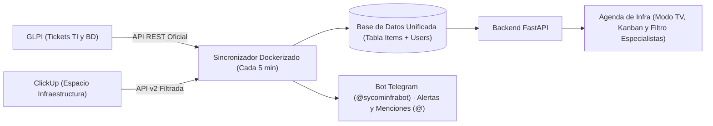

# Propuesta Estratégica: Evolución de la Agenda de Infra y BD

**Destinatario:** Coordinación de Infraestructura y Base de Datos (Sycom)  
**Autor:** Equipo de Infraestructura y Desarrollo  
**Fecha:** Noviembre 2026  
**Versión:** 2.0 — Estado de Implementación y Hoja de Ruta Avanzada  

---

## 1. Resumen Ejecutivo del Estado del Sistema

Se ha consolidado con éxito la **Agenda de Infra y BD**, logrando una integración desatendida y en tiempo real entre **GLPI** y **ClickUp** para todo el equipo operativo:

---

## 2. Matriz de Estado y Mejoras

| # | Módulo / Mejora | Estado Actual | Impacto Operativo |
|---|---|:---:|:---:|
| **M2** | **Bot de Alertas Proactivas y Menciones** (Telegram) | ✅ **100% OPERATIVO EN PRODUCCIÓN** | **Crítico (Resuelto)** |
| **M4** | **Modo TV (Presentación de Sala) y Filtro de Especialistas** | ✅ **100% OPERATIVO EN PRODUCCIÓN** | **Alto (Resuelto)** |
| **M1** | **Cálculo de SLA en Horario Hábil** (Lunes a Viernes 08:00–17:00) | 🟡 **Siguiente Prioridad Inmediata** | **Muy Alto** |
| **M3** | **Generación Desatendida de Informes Mensuales** (PDF y Excel) | ⚪ Planificado (Fase 2B) | **Alto** |
| **M5** | **Triaje y Clasificación Asistida con Inteligencia Artificial** | ⚪ Planificado (Fase 2C) | **Medio** |

---

## 3. Logros Ya Entregados e Implementados

### ✅ M2. Bot de Alertas Tempranas y Menciones (@) en Telegram
- **Bot Oficial Activo:** `@sycominfrabot` integrado en el grupo del equipo.
- **Menciones Directas con Sonido:** Alerta al técnico responsable usando su alias de Telegram (`@Juuan8`, `@Yjimenezg`, `@lapsy0`, `@adonislozada`).
- **Aviso de Nueva Asignación (Inmediato):** En cuanto se crea una tarea en ClickUp o ticket en GLPI, el bot avisa a los especialistas involucrados.
- **Alertas de SLA Preventiva y Crítica:** Notificación al 75% del SLA y al 100% (vencido).
- **Atención de Casos Sin Asignar:** Si entra un ticket sin responsable, etiqueta automáticamente al Coordinador para su asignación.
- **Mecanismo Anti-Spam:** Solo notifica una vez por nivel gracias a la tabla `alert_logs`.

### ✅ M4. Modo TV (Presentación Continua) y Gestión de Especialistas
- **Botón "📺 Modo TV" en el Encabezado:** Acceso instantáneo a pantalla completa diseñado para la pantalla de la sala técnica y reuniones de seguimiento.
- **Carrusel Inteligente de Diapositivas (Rotación cada 18s):**
  1. **Panorama General:** Estadísticas de pendientes, en curso, atrasados y asuntos prioritarios.
  2. **Asuntos Sin Asignar (Oportunidad de Tomar Casos):** Destaca en grande los requerimientos huérfanos con botón directo *"Tomar en GLPI / ClickUp ↗"* para que los especialistas se los asignen en vivo durante la reunión.
  3. **Vistas Individuales por Especialista:** Diapositivas dedicadas para **Juan Fernández**, **Yoxaide Jiménez**, **Luis Acosta** y **Adonis Lozada** con el desglose de su carga activa.
- **Controles de Sala:** Pausa para debatir puntos (`Espacio`), avance/retroceso manual (`←` / `→`) y salida con `Esc`.
- **Filtro Rápido por Responsable:** Desplegable superior en la web para consultar la carga individual en 1 clic.

---

## 4. Próximo Paso Recomendado: M1 (Horario Laboral Hábil)

### El problema que resolveremos:
El cómputo de SLA actual corre 24/7. Si un ticket de Alta prioridad (24 horas de SLA) entra un viernes a las 16:00, actualmente amanece vencido en rojo el sábado por la tarde.

### La solución:
- Contabilizar únicamente de **lunes a viernes, de 08:00 a 17:00**.
- Pausar automáticamente el SLA durante fines de semana y feriados venezolanos.
- Pausar el cronómetro cuando el caso esté en estado `En Espera` (cliente o repuesto).
- **Resultado:** Indicadores de cumplimiento de SLA 100% justos y defendibles ante la Dirección.

