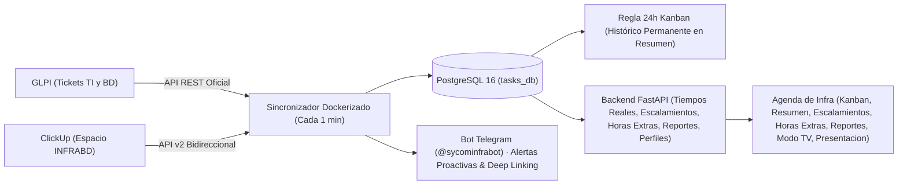

# Propuesta Estratégica: Evolución de la Agenda de Infra y BD

**Destinatario:** Coordinación de Infraestructura y Base de Datos (Sycom)  
**Autor:** Equipo de Infraestructura y Desarrollo  
**Fecha:** Noviembre 2026  
**Versión:** 3.1.0 — Matriz de Implementación Completa, Logros Entregados y Estado Operativo  

---

## 1. Resumen Ejecutivo del Estado del Sistema

Se ha consolidado con éxito la **Agenda de Infra y BD**, alcanzando un sistema maduro, colaborativo y en tiempo real que integra de manera desatendida **GLPI** y **ClickUp** para todo el equipo operativo, incorporando persistencia transaccional en **PostgreSQL 16**, repositorio documental, gestión de horas extras, generación de informes ejecutivos, mapas de calor gerenciales, modo televisión y presentación ejecutiva en diapositivas:

---

## 2. Matriz de Estado y Funcionalidades

| # | Módulo / Mejora | Estado Actual | Impacto Operativo |
|---|---|:---:|:---:|
| **M1** | **Tiempos de Atención y Duración Real por Estado** | **100% OPERATIVO EN PRODUCCIÓN** | **Crítico (Resuelto)** |
| **M2** | **Bot de Alertas Proactivas y Deep Linking** (Telegram `@sycominfrabot`) | **100% OPERATIVO EN PRODUCCIÓN** | **Crítico (Resuelto)** |
| **M3** | **Modo TV para Sala de Operaciones** (Carrusel: Kanban + Gráficos) | **100% OPERATIVO EN PRODUCCIÓN** | **Alto (Resuelto)** |
| **M4** | **Tablero Kanban con 4 Columnas Fijas y Drag & Drop** | **100% OPERATIVO EN PRODUCCIÓN** | **Alto (Resuelto)** |
| **M5** | **Política Inteligente de 24h en Kanban vs Histórico Permanente en Resumen** | **100% OPERATIVO EN PRODUCCIÓN** | **Alto (Resuelto)** |
| **M6** | **Diseño Glassmorphism Translúcido y Cero Emojis (Iconos SVG)** | **100% OPERATIVO EN PRODUCCIÓN** | **Alto (Resuelto)** |
| **M7** | **Ajuste de Fin de Jornada en ClickUp y Horas Locales** | **100% OPERATIVO EN PRODUCCIÓN** | **Alto (Resuelto)** |
| **M8** | **Repositorio Documental de Escalamientos e Inventario IBP (SIMF)** | **100% OPERATIVO EN PRODUCCIÓN** | **Alto (Resuelto)** |
| **M9** | **Generación de Reportes Ejecutivos (Excel .xlsx y PDF Estructurado)** | **100% OPERATIVO EN PRODUCCIÓN** | **Alto (Resuelto)** |
| **M10** | **Tablero de Analítica y Gráficos Visuales de Rendimiento** | **100% OPERATIVO EN PRODUCCIÓN** | **Alto (Resuelto)** |
| **M11** | **Gestión de Perfil de Usuario, Foto/Avatar y Cambio de Contraseña** | **100% OPERATIVO EN PRODUCCIÓN** | **Medio-Alto (Resuelto)** |
| **M12** | **Permisos Ampliados de Creación y Eliminación para Especialistas** | **100% OPERATIVO EN PRODUCCIÓN** | **Alto (Resuelto)** |
| **M13** | **Triaje y Clasificación Asistida con Inteligencia Artificial** | Planificado (Fase 3) | **Medio** |
| **M14** | **Base de Datos Relacional PostgreSQL 16 y Auto-Migrador de Datos** | **100% OPERATIVO EN PRODUCCIÓN** | **Crítico (Resuelto)** |
| **M15** | **Módulo de Horas Extras con Cálculo de Duración en Tiempo Real** | **100% OPERATIVO EN PRODUCCIÓN** | **Alto (Resuelto)** |
| **M16** | **Mapa de Calor de Horas Extras por Especialista y Categoría Técnica** | **100% OPERATIVO EN PRODUCCIÓN** | **Alto (Resuelto)** |
| **M17** | **Presentación Ejecutiva Interactiva en Diapositivas (`presentacion.html`)** | **100% OPERATIVO EN PRODUCCIÓN** | **Medio-Alto (Resuelto)** |
| **M18** | **Paginación Uniforme de 10 Elementos por Página con Controles Centrados** | **100% OPERATIVO EN PRODUCCIÓN** | **Medio (Resuelto)** |

---

## 3. Logros Entregados e Implementados

### 1. Tiempos de Atención y Escalado Reales
- **Desacople total de SLA rígidos:** Enfoque en la duración real y cronología operativa (duración de vida del ticket, tiempo sin atender en pendientes, tiempo activo en curso y tiempo en espera).
- **Fechas clave:** Registro explícito de fecha de recepción en la organización y fecha de escalamiento al área de Infraestructura & BD.

### 2. Política de 24 Horas en Kanban vs Histórico en Resumen
- **Flujo ágil sin saturación:** La columna *Cerrados* del Kanban únicamente muestra actividades cerradas durante las últimas 24 horas.
- **Histórico permanente:** La base de datos y la vista de *Resumen* conservan el 100% de los tickets resueltos para auditoría, consulta y filtros históricos con paginación de 10 registros.

### 3. Modo TV para Salas de Operaciones y Smart TVs
- Carrusel continuo en pantalla completa con alternancia automática entre:
  1. **Tablero Kanban:** Estado en vivo de todas las tareas operativas.
  2. **Tablero de Analítica y Gráficos:** Indicadores visuales de rendimiento mensual, distribución por especialista y top clientes.
- Control interactivo: Pausar/Reanudar (`Espacio`), cambio manual (`←` / `→`) y salida rápida (`Esc`).

### 4. Creación y Eliminación de Actividades por Especialistas
- Los especialistas pueden crear nuevas actividades operativas con sincronización bidireccional inmediata hacia ClickUp.
- Los especialistas tienen la potestad de eliminar las actividades creadas por ellos mismos, mientras que la Coordinación mantiene facultades de eliminación global.

### 5. Repositorio Documental de Escalamientos y Catálogo IBP
- Repositorio centralizado de enlaces directos a Google Docs de requerimientos escalados.
- Clasificación por categorías técnicas (CPU, RAM, Disco, Antivirus, PostgreSQL, Servicios, Infraestructura) y vinculación al catálogo de instituciones bancarias SIMF / IBPs.
- Paginación estandarizada de 10 registros por página y buscador instantáneo.

### 6. Control de Horas Extras y Cálculo Dinámico de Tiempos
- Módulo accesible desde la barra lateral y cabecera con botón directo `+ Añadir Hora Extra`.
- Previsualización dinámica de la duración calculada en horas y minutos (`2h 30m / 2.50 hrs`) a medida que se ingresan las fechas de inicio y fin.
- Bloqueo preventivo de guardado si la fecha de fin no es posterior a la de inicio.
- Registro detallado de actividad, proyecto y categoría técnica, con permisos por rol y sin envíos de alertas a canales públicos de Telegram.

### 7. Inteligencia Operativa y Mapas de Calor
- **Matriz IBP x Categoría Técnica (Mapa de Calor):** Muestra visualmente la concentración de incidencias por banco y tecnología, permitiendo filtrar la lista de actividades al hacer clic sobre una celda.
- **Matriz de Horas Extras por Especialista (Mapa de Calor):** Consolida el total de horas extraordinarias por técnico y tecnología, facilitando la auditoría de sobreesfuerzos y el balance de carga.
- Generación con un solo clic de informes ejecutivos en formato **Excel (.xlsx)** con fórmulas y **PDF estructurado** con resumen para Gerencia.

### 8. Base de Datos Relacional PostgreSQL 16 en Producción
- Contenedor dedicado `dashboard_db` montado sobre imagen `postgres:16-alpine` con healthcheck automático.
- Script de migración y sincronización de esquema (`migrate_sqlite_to_pg.py`) para migrar datos históricos desde SQLite sin pérdida de información.
- Conexión de alto rendimiento mediante SQLAlchemy con soporte de fallback local.

### 9. Presentación Ejecutiva en Diapositivas (`presentacion.html`)
- Módulo de 6 diapositivas interactivo integrado en el frontend para exposición ante la Gerencia y la Dirección.
- Soporta modo pantalla completa (`F`), navegación con teclado (`←` / `→` / `Espacio`) y botón de transición directa hacia la aplicación en vivo (`Enter`).

### 10. Perfil de Usuario y Seguridad
- Módulo **Mi Perfil** accesible desde el menú lateral y la cabecera:
  - Personalización de foto de perfil (avatar recortado y optimizado en base64).
  - Actualización de datos de contacto (correo, teléfono, usuario de Telegram, cargo y especialidad).
  - Cambio seguro de contraseñas con verificación de clave actual.
- Interfaz de acceso limpia sin usuarios ni contraseñas guardadas por defecto.

### 11. Alertas Proactivas en Telegram (@sycominfrabot)
- Notificaciones automáticas ante nuevos casos y asignaciones.
- Enlaces directos (*deep linking*) que abren y enfocan automáticamente la actividad en el navegador al hacer clic en el mensaje de Telegram.

---

## 4. Próxima Fase Planificada (Fase 3)

### M13. Triaje y Clasificación Asistida con Inteligencia Artificial
- Sugerencia automática de técnico responsable y cliente basada en el asunto y descripción del ticket.
- Detección de patrones de incidentes recurrentes en bases de datos e infraestructura para generación de alertas preventivas.
- Asistente de redacción de minutas de escalamiento a partir de las notas registradas en los tickets.
