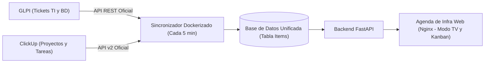
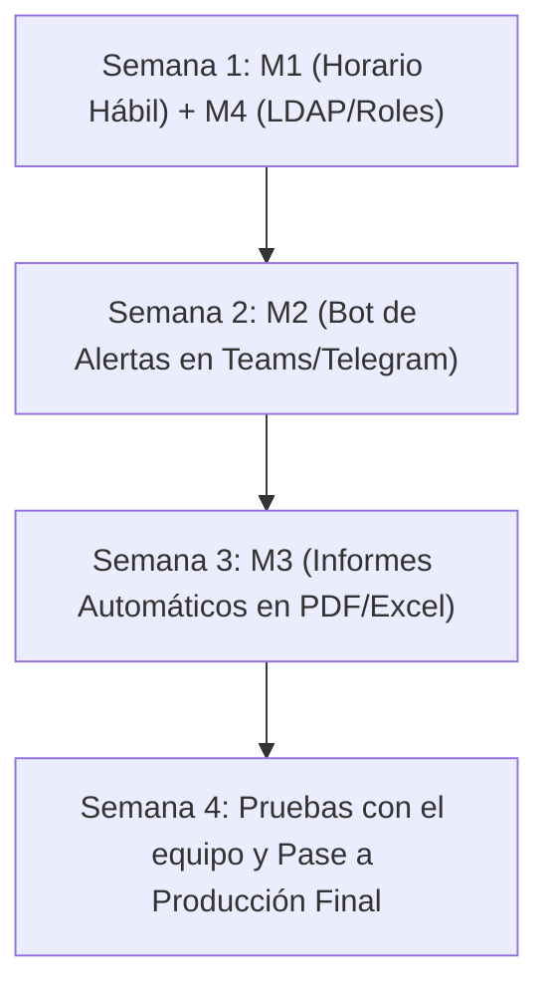

# Propuesta Estratégica: Evolución de la Agenda de Infra y BD

**Destinatario:** Coordinación de Infraestructura y Base de Datos  
**Autor:** Equipo de Desarrollo e Integración de Infraestructura  
**Fecha:** Noviembre 2026  
**Versión:** 1.0 — Entrega Fase 1 y Hoja de Ruta Fase 2  

---

## 1. Resumen Ejecutivo de la Fase 1 (Estado Actual)

Se ha completado con éxito la primera fase del **Dashboard Unificado de Seguimiento Operativo**, resolviendo la dispersión de información entre las dos herramientas principales del área:

### Principales Hitos Entregados:
1. **Integración limpia mediante APIs oficiales:** Sin *web scraping* ni scripts frágiles. Se habilitó la API REST nativa de GLPI (v1 y v2.3) y la API v2 de ClickUp mediante tokens seguros.
2. **Modelo de Datos Unificado:** Normalización automática de estados (`pendiente`, `en curso`, `en espera`, `cerrado`) y prioridades (`Crítica`, `Alta`, `Media`, `Baja`).
3. **Motor de Cálculo de SLA en tiempo real:** Semáforos visuales dinámicos (🟢 Verde `<75%`, 🟡 Amarillo `75–99%`, 🔴 Rojo `≥100%`) y detección de vencimientos.
4. **Despliegue empresarial en Docker:** Empaquetado completo con Docker Compose y Nginx Reverse Proxy, permitiendo acceso centralizado tanto en la red interna como a través de IP pública/VPN.
5. **Control de Versiones y Documentación:** Repositorio en GitHub con variables sensibles aisladas bajo buenas prácticas de seguridad.

---

## 2. Matriz de Sugerencias de Mejora (Fase 2)

A continuación se presenta la matriz priorizada de mejoras recomendadas para maximizar el impacto operativo y la visibilidad de la coordinación:

| # | Mejora Propuesta | Impacto Operativo | Esfuerzo Estimado | Prioridad |
|---|---|:---:|:---:|:---:|
| **M1** | **Cálculo de SLA en Horario Hábil** (Calendario Laboral) | **Alto** | 3 - 4 días | **P1 (Crítica)** |
| **M2** | **Bot de Alertas Proactivas** (Telegram / Microsoft Teams) | **Muy Alto** | 4 - 5 días | **P1 (Crítica)** |
| **M3** | **Generación Desatendida de Informes Mensuales** (PDF y Excel) | **Alto** | 5 días | **P2 (Alta)** |
| **M4** | **Autenticación con Directorio Activo / LDAP** (Roles y Modo TV) | **Medio** | 3 días | **P2 (Alta)** |
| **M5** | **Triaje y Clasificación Asistida con Inteligencia Artificial** | **Medio** | 4 días | **P3 (Deseable)** |

---

## 3. Detalle de las Mejoras Sugeridas para la Coordinación

### M1. Cálculo de SLA en Horario Hábil (Laboral) vs Horario Corrido
> **El problema actual:** El cálculo actual mide el tiempo en horas corridas (24/7). Si un ticket entra un viernes a las 16:30 con SLA de 24 horas (Alta prioridad), el sistema lo marca en rojo el sábado por la tarde, amaneciendo atrasado el lunes a primera hora injustamente para el técnico.

* **Solución propuesta:** Incorporar una biblioteca de horario laboral (`workalendar` o reglas personalizadas) que compute únicamente:
  - De lunes a viernes, de 08:00 a 17:00.
  - Pausa automática durante fines de semana y feriados nacionales.
  - Pausa de SLA si el ticket pasa a estado `En Espera` (esperando respuesta de cliente o proveedor).
* **Beneficio para la coordinación:** Métricas 100% justas y defendibles ante gerencia sobre los tiempos de respuesta reales del equipo.

---

### M2. Bot de Alertas Tempranas en Telegram o Microsoft Teams
> Pasar de un modelo **reactivo** (abrir la web para ver qué se venció) a un modelo **preventivo** (el sistema te avisa antes de que se venza).

* **Solución propuesta:** Integrar un webhook o bot ligero conectado al planificador de tareas:
  - 🟡 **Alerta preventiva (75% del SLA consumido):** *"Atención: El ticket #20 (Restaurar BD) de MFC ha consumido el 75% de su tiempo límite."*
  - 🔴 **Alerta de escalamiento:** Aviso inmediato al coordinador si un asunto crítico no ha sido atendido en 2 horas.
  - ⏰ **Aviso de estancamiento:** Notificación de tickets que llevan más de 3 días hábiles sin ninguna actualización o seguimiento.
* **Beneficio para la coordinación:** Reducción drástica del porcentaje de tickets fuera de SLA sin requerir supervisión humana constante.

---

### M3. Generación Automática de Informes Mensuales (PDF y Excel)
* **Solución propuesta:** Un job automático que se ejecute el primer día de cada mes a las 06:00 AM y envíe al correo de la Coordinación:
  1. **Informe Ejecutivo en PDF (diseño formal):** Gráficos de tendencia, porcentaje global de cumplimiento de SLA, MTTR (Tiempo Medio de Resolución) y análisis comparativo mes anterior vs mes actual.
  2. **Libro de Trabajo en Excel (.xlsx):** Datos crudos con tablas dinámicas desglosadas por cliente/entidad, técnico responsable y categoría de falla.
* **Beneficio para la coordinación:** Ahorro de 4 a 8 horas mensuales de consolidación manual en hojas de cálculo para preparar la rendición de cuentas a la Dirección.

---

### M4. Autenticación Centralizada con Directorio Activo (LDAP / AD)
* **Solución propuesta:** Conectar el backend con el controlador de dominio de la empresa para habilitar 3 perfiles de acceso:
  - **Perfil Pantalla / Modo TV:** Acceso público de solo lectura sin credenciales, optimizado para la pantalla fija de la sala técnica (rotación automática de vistas cada 20 segundos).
  - **Perfil Técnico:** Inicia sesión con su usuario de Windows; el dashboard se abre automáticamente filtrando "Mis Asuntos Asignados".
  - **Perfil Coordinador:** Acceso total con filtros globales, mantenedor de metas de SLA y exportación de reportes.
* **Beneficio para la coordinación:** Seguridad reforzada, auditoría de accesos y personalización de la experiencia para cada miembro del equipo.

---

### M5. Triaje y Sugerencia de Categoría con Inteligencia Artificial Ligera
* **Solución propuesta:** Un agente de procesamiento de lenguaje natural (NLP) que analice el asunto y la descripción de los requerimientos entrantes:
  - Si el ticket dice *"Fallo al emitir factura en Profit Plus"*, sugiere automáticamente: `Categoría: Base de Datos`, `Prioridad: Alta`.
  - Si dice *"Cambio de tóner o driver de impresora"*, sugiere: `Categoría: Soporte TI`, `Prioridad: Media/Baja`.
* **Beneficio para la coordinación:** Estandarización de la información desde el primer minuto y reducción del tiempo de asignación inicial.

---

## 4. Cronograma Sugerido de Implementación (Fase 2)

---

## 5. Conclusión y Recomendación

La infraestructura montada en la Fase 1 es sólida, modular y está completamente contenerizada en Docker. Las mejoras propuestas no requieren cambiar la arquitectura base, sino simplemente activar módulos adicionales sobre el backend que ya está funcionando.

Se recomienda priorizar de inmediato **M1 (Horario Hábil)** y **M2 (Alertas en Telegram/Teams)** por su impacto directo en la satisfacción de los clientes internos y externos.

