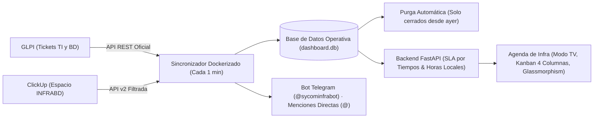

# Propuesta Estratégica: Evolución de la Agenda de Infra y BD

**Destinatario:** Coordinación de Infraestructura y Base de Datos (Sycom)  
**Autor:** Equipo de Infraestructura y Desarrollo  
**Fecha:** Noviembre 2026  
**Versión:** 2.1 — Estado de Implementación, Logros Recientes y Hoja de Ruta  

---

## 1. Resumen Ejecutivo del Estado del Sistema

Se ha consolidado con éxito la **Agenda de Infra y BD**, logrando una integración desatendida y en tiempo real entre **GLPI** y **ClickUp** para todo el equipo operativo:

---

## 2. Matriz de Estado y Funcionalidades

| # | Módulo / Mejora | Estado Actual | Impacto Operativo |
|---|---|:---:|:---:|
| **M1** | **SLA por Tiempos y Duración Real por Estado** | ✅ **100% OPERATIVO EN PRODUCCIÓN** | **Crítico (Resuelto)** |
| **M2** | **Bot de Alertas Proactivas y Menciones** (Telegram `@sycominfrabot`) | ✅ **100% OPERATIVO EN PRODUCCIÓN** | **Crítico (Resuelto)** |
| **M3** | **Modo TV (Presentación de Sala) y Carrusel por Especialista** | ✅ **100% OPERATIVO EN PRODUCCIÓN** | **Alto (Resuelto)** |
| **M4** | **Tablero Kanban con 4 Columnas Fijas para TV** | ✅ **100% OPERATIVO EN PRODUCCIÓN** | **Alto (Resuelto)** |
| **M5** | **Política de Retención Inteligente de Cerrados (Ayer + Hoy)** | ✅ **100% OPERATIVO EN PRODUCCIÓN** | **Alto (Resuelto)** |
| **M6** | **Diseño Glassmorphism Translúcido y Cero Emojis (SVG)** | ✅ **100% OPERATIVO EN PRODUCCIÓN** | **Alto (Resuelto)** |
| **M7** | **Ajuste de Fin de Jornada en ClickUp y Zona Horaria Local** | ✅ **100% OPERATIVO EN PRODUCCIÓN** | **Alto (Resuelto)** |
| **M8** | **Cálculo de SLA en Horario Hábil** (Lunes a Viernes 08:00–17:00) | 🟡 **Siguiente Prioridad Inmediata** | **Muy Alto** |
| **M9** | **Generación Desatendida de Informes Mensuales** (PDF y Excel) | ⚪ Planificado (Fase 2B) | **Alto** |
| **M10** | **Triaje y Clasificación Asistida con Inteligencia Artificial** | ⚪ Planificado (Fase 2C) | **Medio** |

---

## 3. Logros Entregados e Implementados Recientemente

### ✅ 1. SLA Dinámico por Tiempo y Duración Transcurrida
- **Contextual al estado del ticket:**
  - **Cerrado:** Muestra la duración real total de vida del ticket (ej: `Duró 2h 15m` o `Duró 1d 4h`).
  - **Pendiente (To Do):** Tiempo que lleva en cola sin ser atendido (ej: `Sin atender: 45m`).
  - **En Curso (In Progress):** Tiempo acumulado de atención técnica activa (ej: `En atención: 3h 10m`).
  - **En Espera:** Tiempo transcurrido en pausa por cliente o proveedor (ej: `En espera: 1h`).
- **Desglose de SLA contractual:** Se acompaña con el `% consumido` y el cálculo de holgura (`Restan Xh Ym` o `+Xh Ym excedido`).
- **Presencia uniforme:** Disponible en la columna principal de la tabla, en tarjetas Kanban, en modal detalle y en Modo TV.

### ✅ 2. Política de Retención y Purga de Asuntos Cerrados
- **Foco 100% en el presente:** Anteriormente se acumulaban decenas de tickets cerrados históricos.
- **Regla implementada:** El dashboard y la base de datos operativa únicamente conservan y muestran los tickets cerrados desde el día de ayer en adelante (`closed_at >= ayer 00:00:00`).
- **Purga automática en cada sincronización:** Todo ticket cerrado anterior a ayer se depura de la base de datos local, manteniendo el sistema liviano y de carga instantánea.

### ✅ 3. Modo TV para Salas Técnicas y Televisores Inteligentes
- **Botón "Modo TV" en cabecera:** Acceso a pantalla completa optimizado para presentaciones y Smart TVs.
- **Carrusel rotativo (cada 18 segundos):**
  1. *Panorama General:* Métricas de pendientes, en atención, atrasados y asuntos prioritarios.
  2. *Casos Sin Asignar (Oportunidad de Tomar Casos):* Visibilidad de requerimientos sin responsable con botón directo *"Tomar en GLPI / ClickUp ↗"*.
  3. *Diapositivas Individuales por Especialista:* Vistas dedicadas para Juan Fernández, Yoxaide Jiménez, Luis Acosta y Adonis Lozada.
- **Controles interactivos:** Pausar para debatir (`Espacio`), cambiar diapositiva (`←` / `→`) y salir con `Esc`.

### ✅ 4. Tablero Kanban con 4 Columnas Fijas
- **Visualización en pantallas de TV:** Se fijó la cuadrícula a `repeat(4, minmax(220px, 1fr))` eliminando el colapso a 2 columnas. Las 4 fases (**Pendientes**, **En Curso**, **En Espera** y **Cerrados**) se muestran siempre en una sola línea horizontal.

### ✅ 5. Estilo Glassmorphism Translúcido y Sin Emojis
- **Efecto de cristal traslúcido:** Tarjetas, filtros, columnas y paneles con fondo diáfano (`rgba(255, 255, 255, 0.025 - 0.045)` y `backdrop-filter: blur(16px)`).
- **Luces ambientales suaves:** Orbes de luz de fondo sutiles sin resplandores chillones que cansen la vista en pantallas de TV.
- **Iconografía 100% profesional:** Eliminación total de emojis en favor de iconos vectoriales SVG limpios.

### ✅ 6. Ajuste de Fin de Jornada en ClickUp y Zona Horaria Local
- **Corrección de fechas límite "Hoy" de ClickUp:** Si un usuario selecciona "Hoy" en ClickUp sin hora específica, el sistema ya no lo marca como vencido en la madrugada, sino que le otorga el plazo hasta el fin de la jornada (`23:59:59`).
- **Ajuste de hora local:** Horas convertidas a la zona horaria del navegador/usuario (9:00 AM en lugar de hora UTC 13:00).

### ✅ 7. Bot de Alertas Tempranas en Telegram (`@sycominfrabot`)
- Notificaciones de asignación inmediata con mención directa sonora (`@alias`).
- Alertas preventivas al 75% del SLA y críticas al 100% (vencido).
- Alerta al coordinador sobre casos nuevos sin asignar.
- Filtro anti-spam (una sola alerta por nivel).

---

## 4. Próxima Prioridad Recomendada: M8 (SLA en Horario Laboral Hábil)

### El problema actual:
El cálculo de SLA actual es continuo (24/7). Si un ticket con 24 horas de SLA ingresa un viernes a las 16:00, el sistema actualmente lo contabiliza durante el fin de semana y amanece vencido el sábado por la tarde.

### La solución propuesta:
- Contabilizar el cronómetro exclusivamente de **lunes a viernes de 08:00 a 17:00**.
- Congelar el conteo durante fines de semana y días feriados.
- Congelar el conteo cuando el estado pase a `En Espera`.
- **Beneficio:** Métricas de cumplimiento de SLA 100% justas y auditables para la Dirección.

---

## 5. Módulos Futuros Planificados

* **M9. Generación de Reportes Ejecutivos (PDF / Excel):** Generación con 1 clic de métricas mensuales de rendimiento por especialista, volumen por cliente y tiempos promedio de atención.
* **M10. Triaje Asistido con Inteligencia Artificial:** Sugerencia automática de especialista y cliente según el texto descriptivo del ticket.
