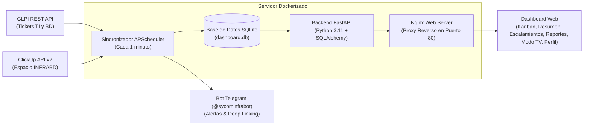

# Agenda de Infra · Infraestructura y Base de Datos (Sycom)

Sistema integral de gestión operativa y consolidación en tiempo real que unifica los requerimientos y tickets de **GLPI** y las tareas de **ClickUp** en un único tablero de control colaborativo, con métricas de tiempo de atención, repositorio documental, generación de informes ejecutivos y presentación para salas de operaciones.

**Versión actual:** `v2.9.2` (Noviembre 2026)

---

## Objetivo del Proyecto

Eliminar la dispersión operativa entre GLPI y ClickUp permitiendo al equipo de Infraestructura y Base de Datos:
- **Visualización Unificada:** Monitorear en una sola pantalla el flujo de trabajo dividido en **Pendientes, En Curso, En Espera y Cerrados**.
- **Regla Inteligente de 24 Horas en Kanban:** La columna *Cerrados* del Kanban muestra únicamente las actividades resueltas en las últimas 24 horas para mantener un flujo limpio y ágil, mientras que la vista de **Resumen** conserva el histórico permanente completo en la base de datos local para auditoría y consulta.
- **Tiempos de Atención y Escalado:** Cronometrar la duración real de atención, fecha de recepción en la organización y fecha de escalada a Infraestructura y Base de Datos.
- **Gestión Colaborativa de Actividades:** Creación de nuevas actividades tanto por **Coordinadores** como por **Especialistas**, con sincronización automática bidireccional hacia ClickUp.
- **Control de Eliminación de Actividades:** Los Especialistas pueden eliminar las actividades creadas por ellos mismos, mientras que los Coordinadores tienen permisos de eliminación global.
- **Repositorio de Escalamientos (Google Docs):** Base de datos documental conectada con enlaces a minutas, reportes de escalamiento e inventario de entidades bancarias **SIMF / IBPs**.
- **Módulo de Reportes Ejecutivos (M9):** Generación automática de informes de gestión en formatos **Excel (.xlsx)** y **PDF estructurado** listos para la Gerencia.
- **Tablero de Analítica y Gráficos:** Indicadores visuales de rendimiento mensual, distribución por especialista y top clientes atendidos.
- **Modo TV para Sala de Operaciones:** Carrusel interactivo para pantallas y Smart TVs con diapositivas del Tablero Kanban y de Analítica de Indicadores.
- **Gestión de Mi Perfil:** Autenticación por roles (Coordinador, Especialista, Analista), personalización de foto de perfil (avatar optimizado), datos personales, teléfono, Telegram y cambio de contraseñas.
- **Alertas Proactivas en Telegram:** Bot (@sycominfrabot) con notificaciones tempranas y enlaces directos (*deep linking*) que abren la actividad seleccionada en el navegador.

---

## Arquitectura del Sistema



---

## Módulos y Capacidades del Sistema

### 1. Tablero Kanban & Vista de Resumen
- 4 columnas fijas: **Pendientes**, **En curso**, **En espera** y **Cerrados**.
- Arrastre interactivo (*Drag & Drop*) para cambiar estados en tiempo real con sincronización hacia ClickUp.
- **Filtro de 24 Horas en Kanban:** Oculta actividades cerradas con más de 24 horas para evitar la acumulación visual.
- **Vista de Resumen:** Tabla completa con historial acumulativo permanente, filtros por origen, responsable, prioridad y buscador en vivo.

### 2. Creación y Eliminación de Actividades
- Acceso para **Coordinadores** y **Especialistas**.
- Formulario de creación con selección de subproyecto (SIMF, SGLPAR, Gestión Sycom o personalizado), prioridad, responsable y descripción.
- Creación transparente en la base de datos local y en ClickUp mediante su API v2.
- Los especialistas pueden eliminar las actividades que hayan registrado ellos mismos.

### 3. Repositorio Documental de Escalamientos & IBPs
- Catálogo de enlaces directos a Google Docs clasificados por categoría operativa (CPU, RAM, Disco, Antivirus, PostgreSQL, Servicios, Infraestructura).
- Vinculación opcional con el inventario bancario de IBPs (SIMF) y registro de recomendaciones técnicas.
- Fila expandible con detalle completo del caso y notas técnicas.

### 4. Reportes Ejecutivos & Analítica
- Generación con 1 clic de informes en **Excel** y **PDF** estructurado con métricas de gestión mensual y desglose por especialista.
- Vista analítica con gráficos de distribución, volumen por cliente y promedio de tiempos de atención.

### 5. Modo TV (Presentación en Pantallas)
- Optimizado para televisores de salas de control y pantallas compartidas.
- Carrusel rotativo continuo que alterna entre el **Tablero Kanban operativo** y el **Tablero de Indicadores y Gráficos**.
- Controles de teclado: Pausar/Reanudar (`Espacio`), Navegar (`←` / `→`) y Salir (`Esc`).

### 6. Perfil de Usuario y Autenticación RBAC
- Roles: **Coordinador** (gestión total y reportes ejecutivos), **Especialista** (gestión operativa, creación y eliminación propia), **Analista** (seguimiento y visualización).
- Login manual limpio y seguro sin credenciales precargadas.
- Panel **Mi Perfil**: Foto de perfil (avatar recortado y optimizado en base64), datos de contacto, especialidad y cambio de contraseña.

---

## Despliegue Rápido con Docker

### Requisitos Previos
- Servidor Linux (Ubuntu 20.04 / 22.04 / 24.04 LTS recomendado).
- Docker Engine 24+ y Docker Compose v2.

### Pasos de Instalación

1. **Clonar el repositorio:**
   ```bash
   git clone https://github.com/JuanFZ/infra-agenda.git /opt/tasks-infra
   cd /opt/tasks-infra
   ```

2. **Configurar las variables de entorno:**
   ```bash
   cp backend/.env.example backend/.env
   nano backend/.env
   ```

   *Variables requeridas:*
   ```env
   # GLPI API
   GLPI_URL=http://<IP_GLPI>/apirest.php
   GLPI_USER=usuario_tecnico
   GLPI_PASS=password_tecnico
   GLPI_APP_TOKEN=tu_app_token_glpi

   # ClickUp API
   CLICKUP_TOKEN=pk_tu_token_aqui
   CLICKUP_TEAM_ID=31558859
   CLICKUP_SPACE_ID=90151745404
   CLICKUP_LIST_ID=901509176390

   # Telegram Bot (Opcional pero recomendado)
   TELEGRAM_BOT_TOKEN=tu_bot_token_aqui
   TELEGRAM_CHAT_ID=-100xxxxxxxxxx

   # Base de datos y Sincronización
   DATABASE_URL=sqlite:///./dashboard.db
   SYNC_INTERVAL_MINUTES=1
   ```

3. **Iniciar los contenedores:**
   ```bash
   docker compose up -d --build
   ```

4. **Acceder al sistema:**
   - **Dashboard Web:** `http://<IP_DEL_SERVIDOR>` (puerto 80)
   - **Documentación Swagger API:** `http://<IP_DEL_SERVIDOR>:8000/docs`

---

## Actualización del Sistema en Producción

Para aplicar las últimas mejoras y versiones publicadas:

```bash
cd /opt/tasks-infra
git fetch --tags
git checkout v2.9.2
docker compose down
docker compose up -d --build
```

---

## Consulta e Inspección de la Base de Datos

La base de datos SQLite se encuentra almacenada en el archivo persistente `/app/dashboard.db` dentro del contenedor `dashboard_backend`.

### Tablas Principales:
- `items`: Actividades consolidadas (ClickUp, GLPI y locales).
- `users`: Usuarios, roles, datos de perfil y hashes de contraseña.
- `escalation_documents`: Base documental de escalamientos y Google Docs.
- `ibps`: Catálogo de instituciones bancarias SIMF.
- `generated_reports`: Registro de informes mensuales generados.
- `sync_logs` y `alert_logs`: Auditoría de sincronización y alertas Telegram.

### Comandos de Consulta:

1. **Listar tablas existentes:**
   ```bash
   docker exec -it dashboard_backend sqlite3 /app/dashboard.db ".tables"
   ```

2. **Consultar actividades recientes:**
   ```bash
   docker exec -it dashboard_backend sqlite3 -header -column /app/dashboard.db \
     "SELECT id, source, external_id, title, status, assignee_name FROM items ORDER BY id DESC LIMIT 10;"
   ```

3. **Consulta directa con Python (sin depender de binarios externos):**
   ```bash
   docker exec -it dashboard_backend python -c "import sqlite3; c=sqlite3.connect('/app/dashboard.db'); print([r[0] for r in c.execute('SELECT name FROM sqlite_master WHERE type=\"table\";')])"
   ```

4. **Exportar la base de datos para abrirla en DB Browser for SQLite o DBeaver:**
   ```bash
   docker cp dashboard_backend:/app/dashboard.db ./dashboard.db
   ```

---

## Estructura del Repositorio

```
tasks-infra/
├── backend/
│   ├── Dockerfile                # Imagen Python 3.11-slim con utilidades SQLite
│   ├── requirements.txt          # Dependencias (FastAPI, SQLAlchemy, openpyxl, reportlab, etc.)
│   ├── test_escalations.py       # Pruebas unitarias de backend
│   └── app/
│       ├── config.py             # Configuración y variables de entorno
│       ├── database.py           # Conexión ORM SQLite / PostgreSQL
│       ├── models.py             # Modelos ORM (Item, User, Escalation, IBP, Report)
│       ├── main.py               # Endpoints REST API y lógica de negocio
│       └── sync/
│           ├── glpi_client.py    # Conector oficial GLPI REST API
│           ├── clickup_client.py # Conector oficial ClickUp API v2
│           ├── telegram.py       # Notificaciones proactivas con deep-linking
│           └── scheduler.py      # Tarea programada de sincronización
├── frontend/
│   ├── index.html                # Interfaz completa Glassmorphism (HTML5 + CSS + JS)
│   ├── nginx.conf                # Configuración de proxy inverso Nginx
│   └── test_deeplink.js          # Pruebas de interfaz y deep linking
├── docker-compose.yml            # Orquestación de servicios Backend y Frontend
├── README.md                     # Documentación general del sistema
└── PROPUESTA_MEJORAS_FASE2.md    # Propuesta estratégica y matriz de estado
```

---

## Licencia y Soporte

Desarrollado y mantenido para la **Coordinación de Infraestructura y Base de Datos (Sycom)**.
Para requerimientos adicionales o soporte técnico, contactar al equipo de administración de sistemas.
