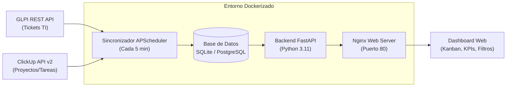

# Mesa de Control · Infraestructura y Base de Datos

Sistema centralizado de seguimiento y gestión operativa en tiempo real que consolida los requerimientos y tickets de **GLPI** y las tareas de **ClickUp** en un único tablero de control unificado.

---

## 🎯 Objetivo del Proyecto

Eliminar la dispersión de información entre plataformas operativas, permitiendo a la Coordinación de Infraestructura y Base de Datos:
- Visualizar en una sola pantalla qué está **pendiente, en curso, en espera, atrasado y cerrado**.
- Monitorear el **cumplimiento de SLA** mediante semáforos inteligentes (🟢 Verde, 🟡 Amarillo, 🔴 Rojo).
- Conocer la **carga de trabajo por técnico** y el estado por cliente/entidad.
- Contar con un **Modo TV** para pantallas en la sala de operaciones.

---

## 🏗️ Arquitectura del Sistema



---

## 🚀 Despliegue Rápido con Docker

### Requisitos previos
- Docker Engine 24+ y Docker Compose v2.

### Pasos de instalación

1. **Clonar el repositorio:**
   ```bash
   git clone https://github.com/JuanFZ/infra-agenda.git /opt/tasks-infra
   cd /opt/tasks-infra
   ```

2. **Configurar las variables de entorno:**
   Crea el archivo `backend/.env` basándote en la plantilla:
   ```bash
   cp backend/.env.example backend/.env
   nano backend/.env
   ```

   *Contenido requerido en `backend/.env`:*
   ```env
   # GLPI API
   GLPI_URL=http://<IP_GLPI>/apirest.php
   GLPI_USER=usuario_tecnico
   GLPI_PASS=password
   GLPI_APP_TOKEN=tu_app_token_aqui

   # ClickUp API
   CLICKUP_TOKEN=pk_tu_token_aqui
   CLICKUP_TEAM_ID=31558859

   # Base de datos y Sincronización
   DATABASE_URL=sqlite:///./dashboard.db
   SYNC_INTERVAL_MINUTES=5
   ```

3. **Iniciar los servicios con Docker Compose:**
   ```bash
   docker compose up -d --build
   ```

4. **Acceder a la aplicación:**
   - **Dashboard Web:** `http://<IP_DEL_SERVIDOR>`
   - **Documentación interactiva de la API:** `http://<IP_DEL_SERVIDOR>:8000/docs`

---

## 💻 Desarrollo Local (Windows / Linux)

Si deseas ejecutar o modificar el proyecto directamente sin Docker:

```powershell
# 1. Crear e iniciar entorno virtual (opcional)
python -m venv venv
.\venv\Scripts\Activate.ps1

# 2. Instalar dependencias
pip install -r backend/requirements.txt

# 3. Iniciar el backend con recarga automática
python -m uvicorn app.main:app --app-dir ./backend --reload --port 8000

# 4. Abrir frontend/index.html en el navegador
```

---

## 📊 Reglas de Negocio y Mapeo de Estados

### 1. Normalización de Estados
| Estado Unificado | GLPI (Origen) | ClickUp (Origen) |
|---|---|---|
| **`pendiente`** | 1 (Nuevo) | `to do`, `open`, `abierto` |
| **`curso`** | 2 (Asignado), 3 (Planificado) | `in progress`, `en curso`, `doing` |
| **`espera`** | 4 (En espera) | `waiting`, `en espera`, `blocked` |
| **`cerrado`** | 5 (Resuelto), 6 (Cerrado) | `complete`, `closed`, `done` |

### 2. Semáforo de Cumplimiento de SLA
Calcula el tiempo transcurrido respecto al plazo límite del ticket o tarea:
- 🟢 **Verde (`< 75%` del tiempo consumido):** En control.
- 🟡 **Amarillo (`75% - 99%` consumido):** Próximo a vencer.
- 🔴 **Rojo (`≥ 100%` consumido):** Fuera de SLA / Atrasado.

*SLA por defecto si GLPI no tiene tiempo asignado:*
- **Crítica:** 4 horas
- **Alta:** 24 horas
- **Media:** 72 horas
- **Baja:** 120 horas

---

## 🔌 Endpoints de la API REST

| Método | Endpoint | Descripción |
|---|---|---|
| `GET` | `/api/kpis` | Métricas generales (pendientes, en curso, cumplimiento % SLA). |
| `GET` | `/api/items` | Listado consolidado con filtros (`src`, `status`, `prio`, `q`). |
| `GET` | `/api/team` | Carga de trabajo y asuntos críticos por técnico. |
| `GET` | `/api/clients` | Desglose de cumplimiento y volumen por cliente/entidad. |
| `POST` | `/api/sync` | Disparador manual para sincronización forzada inmediata. |

---

## 📁 Estructura del Repositorio

```
tasks-infra/
├── backend/
│   ├── app/
│   │   ├── config.py             # Lectura de variables de entorno
│   │   ├── database.py           # Conexión ORM SQLAlchemy
│   │   ├── models.py             # Modelo unificado Item y cálculo de SLA
│   │   ├── sync/
│   │   │   ├── glpi_client.py    # Conector oficial GLPI REST API
│   │   │   ├── clickup_client.py # Conector oficial ClickUp API v2
│   │   │   └── synchronizer.py   # Servicio de sincronización periódica
│   │   └── main.py               # Endpoints FastAPI y Scheduler
│   ├── Dockerfile
│   ├── requirements.txt
│   ├── .env.example
│   └── .env                      # Protegido por .gitignore
├── frontend/
│   └── index.html                # Interfaz interactiva en tiempo real
├── docker-compose.yml            # Orquestación de backend y frontend Nginx
└── README.md
```
