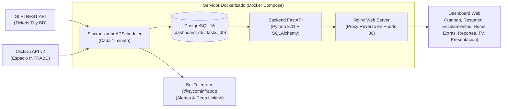

# Agenda de Infra · Infraestructura y Base de Datos (Sycom)

Sistema integral de gestión operativa y consolidación en tiempo real que unifica los requerimientos y tickets de **GLPI** y las tareas de **ClickUp** en un único tablero de control colaborativo, con persistencia transaccional en **PostgreSQL 16**, métricas de tiempo de atención, repositorio documental, gestión de horas extras, generación de informes ejecutivos, mapas de calor gerenciales y presentación para salas de operaciones.

**Versión actual:** `v3.1.0` (Noviembre 2026)

---

## Objetivo del Proyecto

Eliminar la dispersión operativa entre GLPI y ClickUp permitiendo al equipo de Infraestructura y Base de Datos:
- **Visualización Unificada:** Monitorear en una sola pantalla el flujo de trabajo dividido en **Pendientes, En Curso, En Espera y Cerrados**.
- **Regla Inteligente de 24 Horas en Kanban:** La columna *Cerrados* del Kanban muestra únicamente las actividades resueltas en las últimas 24 horas para mantener un flujo limpio y ágil, mientras que la vista de **Resumen** conserva el histórico permanente completo en la base de datos para auditoría y consulta.
- **Tiempos de Atención y Escalado:** Cronometrar la duración real de atención, fecha de recepción en la organización y fecha de escalada a Infraestructura y Base de Datos.
- **Gestión Colaborativa de Actividades:** Creación de nuevas actividades tanto por **Coordinadores** como por **Especialistas**, con sincronización automática bidireccional hacia ClickUp.
- **Control de Eliminación de Actividades:** Los Especialistas pueden eliminar las actividades creadas por ellos mismos, mientras que los Coordinadores tienen permisos de eliminación global.
- **Repositorio de Escalamientos (Google Docs):** Base de datos documental conectada con enlaces a minutas, reportes de escalamiento e inventario de entidades bancarias **SIMF / IBPs**.
- **Módulo de Horas Extras:** Registro ágil de actividades extraordinarias con cálculo automático y en vivo de la duración total (horas y minutos), validación de coherencia temporal y control de acceso por roles sin alertas a canales públicos.
- **Módulo de Reportes Ejecutivos (M9):** Generación automática de informes de gestión en formatos **Excel (.xlsx)** y **PDF estructurado** listos para la Gerencia.
- **Tablero de Analítica y Mapas de Calor:**
  - **Matriz IBP x Categoría Técnica:** Concentración de incidentes por banco y tecnología.
  * **Matriz de Horas Extras:** Distribución de horas acumuladas por especialista y componente técnico con filtrado interactivo directo.
- **Modo TV para Sala de Operaciones:** Carrusel interactivo para pantallas y Smart TVs con diapositivas del Tablero Kanban y de Analítica de Indicadores sin requerir credenciales operativas.
- **Presentación Ejecutiva Integrada (`presentacion.html`):** Plataforma web de diapositivas interactiva en pantalla completa con atajos de teclado y botón directo de transición a la demostración en vivo.
- **Gestión de Mi Perfil:** Autenticación por roles (Coordinador, Especialista, Analista), personalización de foto de perfil (avatar optimizado), datos personales, teléfono, Telegram y cambio de contraseñas.
- **Alertas Proactivas en Telegram:** Bot (@sycominfrabot) con notificaciones tempranas y enlaces directos (*deep linking*) que abren la actividad seleccionada en el navegador.

---

## Arquitectura del Sistema



---

## Módulos y Capacidades del Sistema

### 1. Tablero Kanban & Vista de Resumen
- 4 columnas fijas: **Pendientes**, **En curso**, **En espera** y **Cerrados**.
- Arrastre interactivo (*Drag & Drop*) para cambiar estados en tiempo real con sincronización hacia ClickUp.
- **Sub-estados y motivos de pausa:** Registro estructurado del motivo de espera (cliente, tercero, ventana de mantenimiento).
- **Filtro de 24 Horas en Kanban:** Oculta actividades cerradas con más de 24 horas para evitar la acumulación visual.
- **Vista de Resumen:** Tabla completa con historial acumulativo permanente, paginación centrada de 10 registros por página, filtros por origen, responsable, prioridad y buscador en vivo.

### 2. Creación y Eliminación de Actividades
- Acceso para **Coordinadores** y **Especialistas**.
- Formulario de creación con selección de subproyecto (SIMF, SGLPAR, Gestión Sycom o personalizado), prioridad, responsable y descripción.
- Creación transparente en PostgreSQL y en ClickUp mediante su API v2.
- Los especialistas pueden eliminar las actividades que hayan registrado ellos mismos.

### 3. Repositorio Documental de Escalamientos & IBPs
- Catálogo de enlaces directos a Google Docs clasificados por categoría operativa (CPU, RAM, Disco, Antivirus, PostgreSQL, Servicios, Infraestructura).
- Vinculación opcional con el inventario bancario de IBPs (SIMF) y registro de recomendaciones técnicas.
- Fila expandible con detalle completo del caso y notas técnicas.
- Tabla paginada de 10 registros con búsqueda en vivo.

### 4. Módulo de Horas Extras
- Botón contextual en cabecera y vista dedicada accesible desde el menú lateral.
- Registro ágil de actividades extraordinarias con previsualización dinámica de duración (`2h 30m / 2.50 hrs`).
- Validación estricta que impide guardar registros con rangos de hora invertidos o inconsistentes.
- Clasificación por especialista, proyecto y categoría técnica con descripción obligatoria.
- Privacidad y gobernanza: Especialistas gestionan sus registros y los Coordinadores supervisan el consolidado global. Cero alertas hacia canales de Telegram.

### 5. Reportes Ejecutivos & Mapas de Calor
- Generación con 1 clic de informes en **Excel** y **PDF** estructurado con métricas de gestión mensual y desglose por especialista.
- **Matriz IBP x Categoría Técnica (Mapa de Calor):** Visualización matricial de casos acumulados por entidad bancaria y componente tecnológico.
- **Matriz de Horas Extras por Especialista (Mapa de Calor):** Balance de esfuerzo adicional acumulado por miembro del equipo y tecnología con filtrado interactivo directo.

### 6. Modo TV (Presentación en Pantallas de Sala)
- Optimizado para televisores de salas de control y pantallas compartidas.
- Carrusel rotativo continuo que alterna entre el **Tablero Kanban operativo** y el **Tablero de Indicadores y Gráficos**.
- Controles de teclado: Pausar/Reanudar (`Espacio`), Navegar (`←` / `→`) y Salir (`Esc`).

### 7. Presentación Ejecutiva en Diapositivas (`presentacion.html`)
- Módulo de 6 diapositivas interactivo integrado en el frontend para exposición ante la Gerencia.
- Soporta modo pantalla completa (`F`), navegación con teclado (`←` / `→` / `Espacio`) y botón de transición directa hacia la aplicación en vivo (`Enter`).

### 8. Perfil de Usuario y Autenticación RBAC
- Roles: **Coordinador** (gestión total y reportes ejecutivos), **Especialista** (gestión operativa, creación y eliminación propia), **Analista** (seguimiento y visualización).
- Login manual limpio y seguro sin credenciales precargadas.
- Panel **Mi Perfil**: Foto de perfil (avatar recortado y optimizado en base64), datos de contacto, especialidad y cambio de contraseña.

---

## Despliegue Rápido con Docker

### Requisitos Previos
- Servidor Linux (Ubuntu 20.04 / 22.04 / 24.04 LTS recomendado).
- Docker Engine 24+ y Docker Compose v2.

### Pasos de Instalación

1. **Clonar el repositorio:**
   ```bash
   git clone https://github.com/JuanFZ/infra-agenda.git /opt/tasks-infra
   cd /opt/tasks-infra
   ```

2. **Configurar las variables de entorno:**
   ```bash
   cp backend/.env.example backend/.env
   nano backend/.env
   ```

   *Variables requeridas:*
   ```env
   # GLPI API
   GLPI_URL=http://<IP_GLPI>/apirest.php
   GLPI_USER=usuario_tecnico
   GLPI_PASS=password_tecnico
   GLPI_APP_TOKEN=tu_app_token_glpi

   # ClickUp API
   CLICKUP_TOKEN=pk_tu_token_aqui
   CLICKUP_TEAM_ID=31558859
   CLICKUP_SPACE_ID=90151745404
   CLICKUP_LIST_ID=901509176390

   # Telegram Bot (Notificaciones de tickets y asignaciones)
   TELEGRAM_BOT_TOKEN=tu_bot_token_aqui
   TELEGRAM_CHAT_ID=-100xxxxxxxxxx

   # Base de datos PostgreSQL
   POSTGRES_USER=tasks_user
   POSTGRES_PASSWORD=tasks_secret_2026
   POSTGRES_DB=tasks_db
   DATABASE_URL=postgresql+psycopg2://tasks_user:tasks_secret_2026@db:5432/tasks_db
   SYNC_INTERVAL_MINUTES=1
   ```

3. **Iniciar los contenedores:**
   ```bash
   docker compose up -d --build
   ```

4. **Acceder al sistema:**
   - **Dashboard Web:** `http://<IP_DEL_SERVIDOR>` (puerto 80)
   - **Presentación Ejecutiva:** `http://<IP_DEL_SERVIDOR>/presentacion.html`
   - **Documentación Swagger API:** `http://<IP_DEL_SERVIDOR>:8000/docs`

---

## Actualización del Sistema en Producción

Para aplicar las últimas mejoras y versiones publicadas:

```bash
cd /opt/tasks-infra
git fetch origin --tags
git checkout v3.1.0
docker compose up -d --build
```

Verificar la salud del sistema:
```bash
docker compose ps
curl http://localhost:8000/api/health
```

---

## Consulta e Inspección de la Base de Datos

En producción, la base de datos relacional reside en el contenedor `dashboard_db` bajo **PostgreSQL 16**.

### Tablas Principales:
- `items`: Actividades consolidadas (ClickUp, GLPI y locales).
- `users`: Usuarios, roles, datos de perfil y credenciales.
- `escalation_documents`: Base documental de escalamientos y Google Docs.
- `overtime_records`: Registro de horas extras y cálculos de duración.
- `ibps`: Catálogo de instituciones bancarias SIMF.
- `generated_reports`: Registro de informes mensuales generados.
- `sync_logs` y `alert_logs`: Auditoría de sincronización y alertas Telegram.

### Comandos de Consulta en PostgreSQL:

1. **Listar tablas existentes:**
   ```bash
   docker exec -it dashboard_db psql -U tasks_user -d tasks_db -c "\dt"
   ```

2. **Consultar actividades recientes:**
   ```bash
   docker exec -it dashboard_db psql -U tasks_user -d tasks_db \
     -c "SELECT id, source, external_id, title, status, assignee_name FROM items ORDER BY id DESC LIMIT 10;"
   ```

3. **Consultar total de horas extras registradas:**
   ```bash
   docker exec -it dashboard_db psql -U tasks_user -d tasks_db \
     -c "SELECT specialist_name, category, duration_hours, start_time, end_time FROM overtime_records ORDER BY id DESC LIMIT 5;"
   ```

4. **Generar un dump de respaldo:**
   ```bash
   docker exec -t dashboard_db pg_dump -U tasks_user tasks_db > backup_tasks_db_$(date +%Y%m%d).sql
   ```

---

## Estructura del Repositorio

```
tasks-infra/
├── backend/
│   ├── Dockerfile                # Imagen Python 3.11-slim con utilidades SQLite y PostgreSQL
│   ├── requirements.txt          # Dependencias (FastAPI, SQLAlchemy, psycopg2-binary, openpyxl, reportlab)
│   ├── test_escalations.py       # Pruebas unitarias de escalamientos
│   ├── test_overtime.py          # Pruebas unitarias del módulo de horas extras
│   ├── migrate_sqlite_to_pg.py   # Script de migración automática de datos SQLite a PostgreSQL
│   └── app/
│       ├── config.py             # Configuración y variables de entorno
│       ├── database.py           # Conexión ORM PostgreSQL con soporte dinámico
│       ├── models.py             # Modelos ORM (Item, User, Escalation, OvertimeRecord, IBP, Report)
│       ├── main.py               # Endpoints REST API, analítica y lógica de negocio
│       └── sync/
│           ├── glpi_client.py    # Conector oficial GLPI REST API
│           ├── clickup_client.py # Conector oficial ClickUp API v2
│           ├── telegram.py       # Notificaciones proactivas con deep-linking
│           └── scheduler.py      # Tarea programada de sincronización continua
├── frontend/
│   ├── index.html                # Interfaz completa Glassmorphism (Kanban, Escalamientos, Horas Extras, Reportes)
│   ├── presentacion.html         # Diapositivas interactivas en pantalla completa para la Gerencia
│   ├── nginx.conf                # Configuración de proxy inverso Nginx y enrutamiento web
│   └── test_deeplink.js          # Pruebas unitarias de frontend, interfaz y deep linking
├── docker-compose.yml            # Orquestación de servicios: PostgreSQL 16, Backend API y Frontend Nginx
├── README.md                     # Documentación general y guía operativa
└── PROPUESTA_MEJORAS_FASE2.md    # Matriz de estado estratégico y seguimiento de fases
```

---

## Licencia y Soporte

Desarrollado y mantenido para la **Coordinación de Infraestructura y Base de Datos (Sycom)**.  
Para requerimientos adicionales o soporte técnico, contactar al equipo de administración de sistemas.
