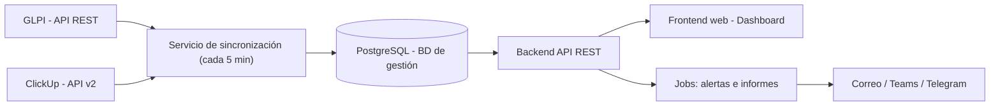
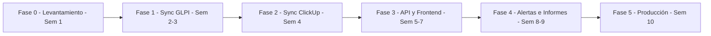

# Plan de trabajo: Mesa de Control de Infraestructura y BD

**Proyecto:** Dashboard unificado de seguimiento (GLPI + ClickUp)
**Solicitante:** Coordinación de Infraestructura y Base de Datos
**Versión:** 1.0, noviembre 2026
**Referencia visual:** `mock-dashboard.html` (prototipo navegable con datos ficticios)

---

## 1. Objetivo

Construir una aplicación web interna que **centralice en una sola vista** los requerimientos de clientes internos y externos registrados en **GLPI** (tickets) y **ClickUp** (tareas y proyectos). Debe permitir:

- Ver en tiempo casi real qué está **pendiente, en curso, en espera, atrasado y cerrado**.
- Controlar el **cumplimiento de SLA** con un semáforo.
- Ver la **carga de trabajo por persona** y el **estado por cliente**.
- Generar **informes automáticos** de gestión (mensual).
- Enviar **alertas** antes de que algo se venza.

### Fuera de alcance (versión 1)
- Crear o editar tickets desde el dashboard. GLPI y ClickUp siguen siendo donde se registra el trabajo; el dashboard **solo lee**.
- Reemplazar GLPI o ClickUp.
- Facturación a clientes.

---

## 2. Arquitectura propuesta

### Stack sugerido
El desarrollador puede proponer otro equivalente si lo justifica.

| Capa | Tecnología sugerida | Alternativa |
|---|---|---|
| Backend / API | Python + FastAPI | Node.js (NestJS) / .NET |
| Sincronización y jobs | APScheduler o Celery | cron + scripts |
| Base de datos | PostgreSQL | SQL Server / MySQL |
| Frontend | React + Vite + ECharts/Recharts | Vue |
| Autenticación | LDAP / Active Directory | Usuarios locales |
| Informes | PDF (WeasyPrint) y Excel (openpyxl) | — |
| Despliegue | Docker Compose en servidor interno | Servicio Windows/Linux |

---

## 3. Modelo de datos

### 3.1 Tabla principal `items` (modelo unificado)

| Campo | Tipo | Descripción |
|---|---|---|
| `id` | PK | Interno |
| `source` | enum | `GLPI` / `ClickUp` |
| `external_id` | texto | ID en el sistema de origen |
| `url` | texto | Enlace directo al ticket o tarea original |
| `title` | texto | Asunto |
| `category` | texto | Base de datos, Servidores, Respaldos, Accesos, Red, Proyecto… |
| `client_id` | FK | Cliente solicitante |
| `client_type` | enum | `Interno` / `Externo` |
| `assignee_id` | FK | Responsable |
| `priority` | enum | `Crítica` / `Alta` / `Media` / `Baja` |
| `status` | enum | `pendiente` / `curso` / `espera` / `cerrado` |
| `status_origin` | texto | Estado tal cual viene del origen |
| `created_at` | timestamp | Fecha de creación |
| `due_at` | timestamp | Vencimiento (SLA o fecha límite) |
| `closed_at` | timestamp | Fecha de resolución o cierre |
| `updated_at` | timestamp | Última modificación en el origen |
| `synced_at` | timestamp | Última sincronización |

### 3.2 Tablas de apoyo
- **`clients`**: nombre, tipo (interno o externo) y SLA personalizado (opcional).
- **`team_members`**: nombre, rol, correo, usuario de GLPI, usuario de ClickUp y usuario de AD.
- **`sla_rules`**: horas de SLA por prioridad (y por cliente, si aplica).
- **`status_mapping`**: equivalencia entre los estados de origen y los estados unificados (configurable).
- **`daily_snapshots`**: foto diaria de los indicadores, para el histórico y los gráficos de tendencia.
- **`item_history`**: cambios de estado y responsable, para auditoría y para calcular tiempos.
- **`sync_log`**: resultado de cada sincronización (OK, error, registros procesados).

### 3.3 Equivalencia de estados (propuesta inicial, a validar)

| Estado unificado | GLPI | ClickUp (ejemplo) |
|---|---|---|
| `pendiente` | 1 – Nuevo | To do / Abierto |
| `curso` | 2 – En curso (asignado), 3 – En curso (planificado) | In progress / En curso |
| `espera` | 4 – En espera | Bloqueado / En espera cliente |
| `cerrado` | 5 – Resuelto, 6 – Cerrado | Complete / Cerrado |

---

## 4. Reglas de negocio

| Regla | Definición |
|---|---|
| **Atrasado** | Asunto abierto con `due_at` anterior al momento actual |
| **Vence hoy** | Asunto abierto con `due_at` entre ahora y las 23:59 de hoy |
| **% SLA consumido** | (ahora, o fecha de cierre, − creación) ÷ (vencimiento − creación) |
| **Semáforo** | 🟢 < 75 % · 🟡 75–99 % · 🔴 ≥ 100 % |
| **Cumplimiento SLA** | Cerrados dentro del plazo ÷ total de cerrados en el período |
| **MTTR** | Promedio de (cierre − creación) de los tickets cerrados en el período |
| **Antigüedad** | Grupos: < 1 d, 1–3 d, 3–7 d, 7–15 d, > 15 d |
| **Carga por persona** | Normal ≤ 5 abiertos · Alta 6–8 · Sobrecargado > 8 (configurable) |

**Origen del vencimiento (`due_at`):**
1. **GLPI:** usar el campo `time_to_resolve` (SLA nativo de GLPI) si está configurado. Si no, aplicar `sla_rules`.
2. **ClickUp:** usar el `due_date` de la tarea.
3. **SLA por defecto (a validar):** Crítica 4 h · Alta 24 h · Media 72 h · Baja 120 h.

> [!IMPORTANT]
> Hay que definir si el SLA se cuenta en **horas corridas** o en **horario hábil** (por ejemplo, de lunes a viernes de 8:00 a 18:00). Esto afecta mucho a los cálculos y debe decidirse en la Fase 0.

---

## 5. Integraciones

### 5.1 GLPI
- **API:** REST (`/apirest.php`) en GLPI 9.5 y 10.x. GLPI 11 incluye además una API nueva de alto nivel (v2, con OAuth2). **Hay que confirmar la versión instalada.**
- **Autenticación:** `App-Token` más el `user_token` de un **usuario técnico de solo lectura**.
- **Datos a extraer:** tickets (estado, prioridad, categoría, solicitante, entidad, técnico asignado, fechas, `time_to_resolve`) y usuarios o grupos.
- **Sincronización incremental:** filtrar por `date_mod` mayor que la última sincronización. La primera carga trae el histórico de los últimos 12 meses.
- **Cliente:** se obtiene de la **Entidad** o del **solicitante** de GLPI (a definir en la Fase 0).

### 5.2 ClickUp
- **API:** ClickUp API v2. Endpoint principal: `GET /team/{team_id}/task` con el filtro `date_updated_gt`.
- **Autenticación:** token personal de un usuario de servicio (o una app OAuth).
- **Opcional:** webhooks para recibir actualizaciones en tiempo real.
- **Cliente:** se toma de un **campo personalizado ("Cliente")** o de la estructura Espacio/Carpeta/Lista (a definir).

### 5.3 Notificaciones
- Correo (SMTP interno).
- Microsoft Teams (webhook de canal) o Telegram (bot), según lo que use el equipo.

---

## 6. Funcionalidades (según el prototipo)

| # | Módulo | Descripción |
|---|---|---|
| F1 | **Resumen** | 8 indicadores, tabla "Atención inmediata", tendencia de 8 semanas, antigüedad, categorías y origen |
| F2 | **Tablero Kanban** | 4 columnas unificadas con borde de color según el semáforo, ordenadas por urgencia |
| F3 | **Atrasados** | Lista detallada, con cuántos son críticos y cuántos de clientes externos |
| F4 | **Equipo** | Tarjeta por persona con su carga y sus asuntos más urgentes |
| F5 | **Clientes** | Semáforo, abiertos, atrasados, críticos y % de SLA por cliente |
| F6 | **Filtros globales** | Origen, tipo de cliente, responsable, prioridad y buscador |
| F7 | **Detalle** | Ventana con datos, % de SLA consumido y enlace al ticket original |
| F8 | **Modo TV** | Pantalla completa con rotación automática de vistas cada 20 s |
| F9 | **Alertas** | Resumen diario a las 08:00, aviso al llegar al 75 % del SLA, aviso al vencer, aviso de asuntos sin actualizar en 3 días |
| F10 | **Informes** | Semanal y mensual (general y por cliente) en PDF y Excel, con envío automático |
| F11 | **Administración** | Mantenedor de clientes, equipo, reglas de SLA y equivalencia de estados |
| F12 | **Seguridad** | Login con AD/LDAP y roles: Coordinador, Técnico, Visualizador (TV) |

---

## 7. Fases y cronograma

Estimación para **1 desarrollador full-stack** a tiempo completo: **unas 10 semanas**.

| Fase | Duración | Entregables | Criterio de aceptación |
|---|---|---|---|
| **0. Levantamiento** | 1 semana | Documento de reglas validado, accesos a las API, equivalencia de estados, lista de clientes y equipo, decisión sobre el horario del SLA | Coordinación aprueba el documento |
| **1. Base y sincronización GLPI** | 2 semanas | Repositorio, BD, sincronizador GLPI (carga inicial e incremental), `sync_log` | Los datos de GLPI cuadran con un muestreo de 30 tickets |
| **2. Sincronización ClickUp** | 1 semana | Sincronizador ClickUp y normalización al modelo unificado | Las tareas de ClickUp aparecen correctamente en la BD |
| **3. API y frontend** | 3 semanas | Endpoints y vistas F1–F8 según el prototipo | Demo funcional con datos reales, aprobada por coordinación |
| **4. Alertas e informes** | 2 semanas | F9, F10 y F11, más los snapshots diarios | Se reciben el resumen diario y el informe semanal de prueba |
| **5. Seguridad, pruebas y salida a producción** | 1 semana | F12, despliegue en el servidor, manual de uso y capacitación al equipo | Sistema en producción y equipo capacitado |

> [!TIP]
> **Primer resultado rápido:** al terminar la Fase 1 ya se puede poner en marcha el **resumen diario por correo** con los datos de GLPI. Aporta valor desde la semana 3, sin esperar al dashboard completo.

### Reuniones de seguimiento
- **Semanal (30 min):** avance, bloqueos y demo de lo construido.
- **Al cierre de cada fase:** validación formal de los entregables.

---

## 8. Requisitos no funcionales

| Aspecto | Requisito |
|---|---|
| **Seguridad** | Tokens en variables de entorno o un gestor de secretos, nunca en el código. Usuario de API **solo lectura**. HTTPS. Acceso solo desde la red interna o VPN. |
| **Rendimiento** | Carga del dashboard en menos de 2 s. Sincronización incremental en menos de 1 min. |
| **Disponibilidad** | Si la API de origen falla, mostrar los últimos datos con el aviso "Última sync: hace X min". |
| **Trazabilidad** | Registro de sincronizaciones y errores. Historial de cambios de estado. |
| **Respaldo** | La BD de gestión entra en la política de respaldos del área. |
| **Mantenibilidad** | Código en Git, README de instalación, archivo `.env.example` y despliegue con Docker. |
| **Compatibilidad** | Chrome y Edge actuales. Pantalla TV en 1080p. |

---

## 9. Lo que la coordinación debe entregar al desarrollador

- [ ] Versión de GLPI y URL de la API
- [ ] App-Token de GLPI y un usuario técnico de solo lectura
- [ ] Token de ClickUp e ID del Workspace (team)
- [ ] Lista de clientes (internos y externos) y cómo se identifican en GLPI y ClickUp
- [ ] Lista del equipo con sus usuarios en GLPI, ClickUp y AD
- [ ] Reglas de SLA por prioridad y por cliente, y si se cuentan en horario hábil o corrido
- [ ] Estados que se usan hoy en GLPI y ClickUp
- [ ] Servidor de despliegue (SO, recursos, acceso) y base de datos
- [ ] Canal de notificaciones (correo SMTP, Teams o Telegram)
- [ ] Formato deseado del informe mensual (o un ejemplo de informe actual)

---

## 10. Riesgos y mitigación

| Riesgo | Impacto | Mitigación |
|---|---|---|
| Datos inconsistentes en GLPI o ClickUp (sin categoría, sin responsable, sin cliente) | Alto | Definir campos obligatorios y mostrar en el dashboard una lista de "datos incompletos" |
| SLA no configurado en GLPI | Medio | Aplicar `sla_rules` propias como respaldo |
| Límites de uso de la API de ClickUp | Bajo | Sincronización incremental y reintentos espaciados |
| Equipo que no actualiza estados | Alto | Alerta de "sin actualizar en 3 días" y revisión semanal con los indicadores |
| Cambios de alcance durante el desarrollo | Medio | Registrar las nuevas ideas en un backlog para la versión 2 |

---

## 11. Backlog para la versión 2 (ideas futuras)

- Resumen ejecutivo semanal redactado con IA.
- Clasificación automática de tickets nuevos (categoría y prioridad).
- Integración con monitoreo (Zabbix, Grafana o PRTG) para abrir tickets automáticamente.
- Registro de horas por cliente para justificar recursos o facturar.
- Vista de calendario con mantenimientos y ventanas de cambio.
- Versión móvil o notificaciones push.

---

## 12. Anexo: indicadores del dashboard

| Indicador | Fórmula | Meta sugerida |
|---|---|---|
| Pendientes | Abiertos con estado `pendiente` | — |
| En curso | Abiertos con estado `curso` | — |
| En espera | Abiertos con estado `espera` | — |
| Atrasados | Abiertos con `due_at` vencido | 0 |
| Vencen hoy | Abiertos que vencen antes de las 23:59 | — |
| Cerrados 7 días | Cerrados en los últimos 7 días | ≥ abiertos del período |
| Cumplimiento SLA | Cerrados en plazo ÷ cerrados | ≥ 90 % |
| MTTR | Promedio del tiempo de resolución | Bajar mes a mes |
| Backlog > 15 días | Abiertos con antigüedad mayor a 15 días | 0 |
